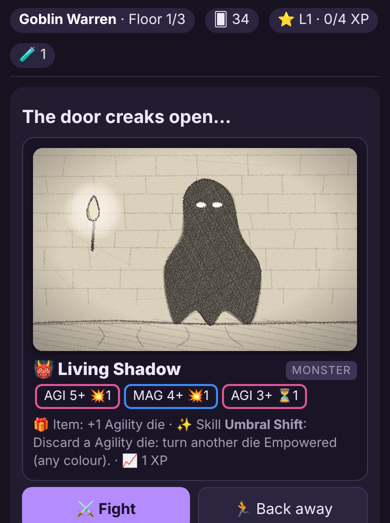

# 🎲 Deck Delve

A self-hosted, phone-friendly co-op dungeon crawl played with dice and cards. It's built for 1–4 players around one table, each using their own phone.



- **No accounts or passwords.** Open the page, type a name, pick a hero and a seat.
- **The server handles everything:** the shuffled deck, every dice roll and the rules. Phones just show the game and send taps.
- **The game saves after every action,** so you can restart the container and carry on where you left off.
- **Every encounter has a hand-drawn pencil-sketch picture.** The art is generated by `tools/make_art.py`.

## Run it

```bash
docker compose up -d --build
```

Then open `http://<server-ip>:8080` on each phone. Tip: use "Add to Home Screen" to get a full-screen app.

Environment variables:

| Variable | Default | Meaning |
|---|---|---|
| `PORT` | `8080` | Port the server listens on inside the container |
| `DATA_DIR` | `/data` | Where the saved game lives |
| `MAX_CLIENTS` | `40` | Maximum number of phones connected at once |

### Behind Traefik

If Traefik uses the Docker provider, drop the `ports:` section and add these labels instead. Join the container to Traefik's network.

```yaml
    networks: [proxy]
    labels:
      - traefik.enable=true
      - traefik.docker.network=proxy
      - traefik.http.routers.deckdelve.rule=Host(`dungeon.example.com`)
      - traefik.http.routers.deckdelve.entrypoints=websecure
      - traefik.http.routers.deckdelve.tls.certresolver=le
      - traefik.http.services.deckdelve.loadbalancer.server.port=8080
```

WebSockets (`/ws`) go through Traefik with no extra configuration.

### Before you put it on the internet

There is one shared game and no login, so anyone who can reach the page can take a seat, kick players or abandon the game. The server limits message size, message rate and the number of connections, but it is meant for people you trust. For public hosting, put it behind your reverse proxy's basic auth or an IP allow-list.

## Dungeons

| Dungeon | Difficulty | Theme and special rules |
|---|---|---|
| Goblin Warren | ★ | Gentle start |
| Sunken Crypt | ★★ | Twisting halls, vicious foes, an anti-magic floor |
| Ember Forge | ★★★ | Vicious foes, treacherous perils |
| 🧛 Castle Nocturne | ★★★★ | Vampires. **Blood drain**: the healthiest hero takes 💥1 at the start of every monster fight. Boss: Lord Malvoren |
| 🧟 Plaguewood Necropolis | ★★★★★ | Zombies. **The horde**: every monster gains an extra STR Σ box. Boss: The Plague Colossus |
| 🐙 Sunken R'lyeh | ★★★★★★ | Cosmic horror. **Madness**: random dice in every roll turn into 1s, even in the boss fight. Boss: Cthulhu, the Dreamer |

Each horror dungeon has its own deck of 15 themed cards. It also uses a few fitting standard monsters and the standard perils.

## How to play

1. **Set up.** Each phone picks a hero and a seat. Someone picks the dungeon (★ to ★★★). Tap **Start**.
2. **Turns.** Every turn costs ⏳2: two cards are discarded from the deck. Then choose one:
   - **Explore:** fill up to 4 face-down doors.
   - **Open or face** a door. You can back away from a door you just opened, but an already-open door must be faced.
3. **Fights.** Tap a die, then tap a box.
   - A box needs a die of its colour (or a black **Empowered** die) showing at least its number.
   - **Σ** boxes add up several dice.
   - 🛡 boxes must be covered first.
   - Every box left uncovered costs 💥 damage and/or ⏳ time.
   - Select two dice and tap **Combine** to make one Empowered die worth the lower of the two.
4. **Perils.** Pick one of two approaches. Only dice of that colour (plus Empowered dice) are rolled.
5. **Skills.** Select the die to pay with, plus a second die if the skill needs a target, then tap the skill. Each skill can be used once per fight, or once per round against the boss.
6. **Rewards.** Each beaten card can be kept as one of:
   - an **item** for one hero (more dice or health)
   - a **skill** for one hero
   - a **potion** (heals 3)
   - **XP**

   Gaining a level gives more slots, a free potion, and bonus Empowered dice in every fight.
7. **Stairs.** When the deck runs out, the stairs appear. Go down whenever you like. Lingering costs 💥1 for every 3 time spent.
8. **The boss** waits after floor 3. In each round, every covered 💀 hurts the boss, then all dice are re-rolled.
9. **Losing.** If any hero hits 0 health, everyone loses. Potions are drunk automatically when a hero would fall.

Any seated player can act at any time, because it's co-op. If a phone loses its seat (new browser or cleared data), tap **"That's me"** on that seat to take it back.

## Art

The encounter pictures in `public/art/` are SVG pencil sketches drawn in code. To regenerate them:

```bash
python3 tools/make_art.py
```

To use your own art, drop a file named after the card into `public/art/` and it replaces the generated one. The file name is the card's name in lowercase with dashes: `spike-trap.svg`, `goblin-king.svg`, and so on.

## Development

```bash
npm install
npm start        # http://localhost:8080
npm test         # plays thousands of bot games to catch rule bugs and gauge difficulty
```

- `engine.js` holds all the rules and card data.
- `server.js` serves the page and syncs the game over WebSockets.
- `public/index.html` is the whole phone client.

The difficulty knobs (box values, player scaling, boss health) are near the top of `engine.js`.

## License

[AGPL-3.0](LICENSE). If you run a modified version for other people, you must share your changes.
